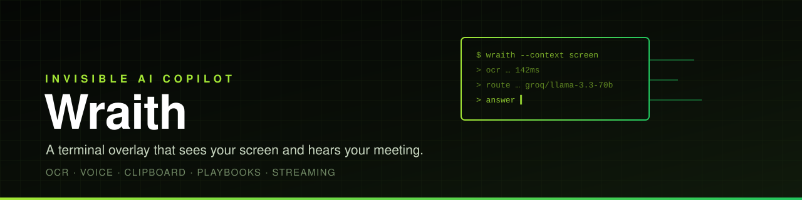
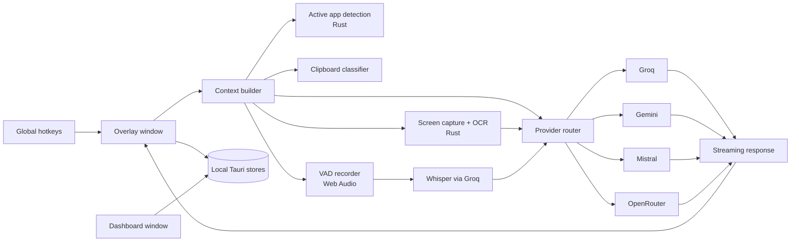

<div align="center">
  
</div>

<div align="center">

**A terminal overlay that sees your screen and hears your meeting.**

[](https://github.com/SyedShah29/Wraith/actions/workflows/ci.yml)
[](LICENSE)
[](https://tauri.app/)
[](https://react.dev/)
[](https://www.rust-lang.org/)

Designed and built by **Syed Hasaan Shah**.

</div>

---

Wraith is an always-on-top, translucent copilot that lives in the corner of your
screen. It captures context from what you are looking at — the active window, a
screenshot, your clipboard, or live audio — and streams a concise answer from
the fastest available model.

It is built as a native Tauri application: the interface is React, the system
integration is Rust, and all state stays local in app stores on disk.

```text
active app + screen + clipboard + audio → context → model router → streamed answer
```

---

## Why Wraith

- **Context without switching apps** — OCR, active-window detection, clipboard
  classification, and live transcription feed the same prompt pipeline.
- **Mode-aware** — Focus, Interview, and Meeting modes change the system prompt
  based on the application in the foreground.
- **Provider-agnostic** — Groq, Gemini, Mistral, and OpenRouter are selected by
  priority and availability.
- **Keyboard-first** — global hotkeys toggle the overlay, ask with context, ask
  with a screenshot, and start recording.
- **Local-first state** — settings, threads, and playbooks live in Tauri's store,
  not a remote account.
- **Terminal-brutalist UI** — acid green on void black, built to disappear until
  you need it.

---

## Features

### Context capture
- `src-tauri/src/commands.rs` — captures the screen, saves a temporary PNG,
  base64-encodes it, and runs Tesseract OCR when installed.
- `src-tauri/src/context.rs` — reports the active application and window title.
- `src/services/context.ts` — detects the app-to-mode mapping, classifies
  clipboard content as code, error, URL, or text, and builds the matching prompt.
- `VoiceActivityDetector` — records speech with the Web Audio API and stops after
  1.5 s of silence, producing WebM segments for transcription.

### Intelligence
- `src/services/ai-router.ts` — priority router over Groq, Gemini, Mistral, and
  OpenRouter, with server-sent-event streaming per provider.
- Gemini receives inline image data for vision prompts; text-only providers get a
  placeholder instead of the image.
- `transcribeAudio` sends recorded audio to Groq Whisper
  (`whisper-large-v3-turbo`).
- `DEFAULT_SETTINGS.systemPrompt` and `MODES` define the base behavior plus
  interview, meeting, and focus suffixes.

### Overlay
- `src/overlay/App.tsx` — command palette, streaming response, transcript bar,
  and action-item panel.
- `CommandPanel.tsx` — slash commands `/ask`, `/code`, `/meet`, `/clip`.
- `ResponseStream.tsx` — incremental markdown rendering with syntax highlighting.
- `ActionItems.tsx` — extracts and displays meeting action items while recording.
- `Pill.tsx` — collapsed state that keeps the overlay unobtrusive.
- Overlay window is transparent, always-on-top, and hotkey-driven
  (`src-tauri/tauri.conf.json`, `src-tauri/capabilities/overlay.json`).

### Dashboard
- `src/dashboard/pages/Hub.tsx` — status and quick actions.
- `History.tsx` — saved threads with search and replay.
- `Models.tsx` — provider keys and model selection.
- `Playbooks.tsx` — reusable context profiles injected into prompts.
- `Settings.tsx` — hotkeys, opacity, position, autostart, and theme.
- All persisted through Tauri store commands (`wraith-settings.json`,
  `wraith-threads.json`, `wraith-playbooks.json`).

---

## Architecture



---

## Tech stack

| Layer | Technology |
| --- | --- |
| Shell | Tauri 2, Rust |
| UI | React 19, Vite 6, TypeScript 5.8 |
| State | Zustand |
| Rendering | react-markdown, remark-gfm, syntax highlighter |
| Screen | `screenshots` crate, optional Tesseract OCR |
| Audio | Web Audio API, MediaRecorder, Groq Whisper |
| Providers | Groq, Google Gemini, Mistral, OpenRouter |
| Storage | Tauri store plugin (JSON) |

---

## Quick start

```bash
git clone https://github.com/SyedShah29/Wraith.git
cd Wraith
npm install
npm run tauri:dev
```

Release build:

```bash
npm run tauri:build
```

### OCR

Install Tesseract for local OCR:

```powershell
winget install UB-Mannheim.TesseractOCR
```

Wraith looks for `C:\Program Files\Tesseract-OCR\tesseract.exe` and uses its
output as OCR context. When Tesseract is not installed, the screenshot is still
attached for vision-capable models.

### First run

1. Open the dashboard with `Ctrl+Shift+W`.
2. Add a Groq or Gemini API key in **Models**.
3. Choose a model.
4. Return to the overlay and press `Ctrl+Enter`.

### Hotkeys

```text
Ctrl+\              toggle overlay
Ctrl+Enter          ask with screen context
Ctrl+Shift+Enter    ask with screenshot attached
Ctrl+Shift+Space    start / stop live recording
Ctrl+Shift+W        open dashboard
```

All hotkeys are rebindable in Settings.

---

## Project layout

```text
src/
├── overlay/        always-on-top copilot UI
├── dashboard/      hub, history, models, playbooks, settings
├── services/       provider router, context detection, VAD
├── shared/         types, constants, defaults
├── store/          Zustand state
└── styles/         terminal-brutalist design system
src-tauri/
├── src/            Rust commands: capture, OCR, active app, windows
├── capabilities/   window permissions
└── tauri.conf.json window and bundle configuration
```

---

## Author

Built end-to-end by **Syed Hasaan Shah**.

---

## License

Released under the [MIT License](LICENSE).
